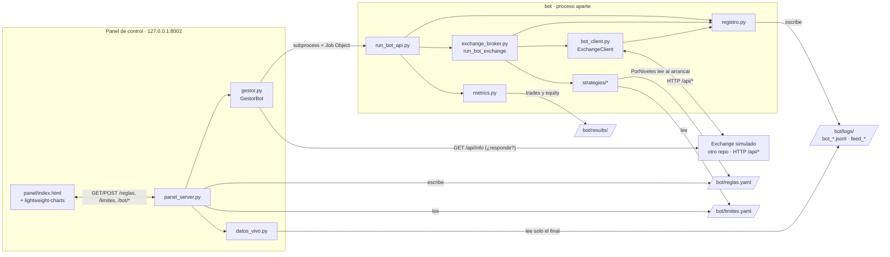
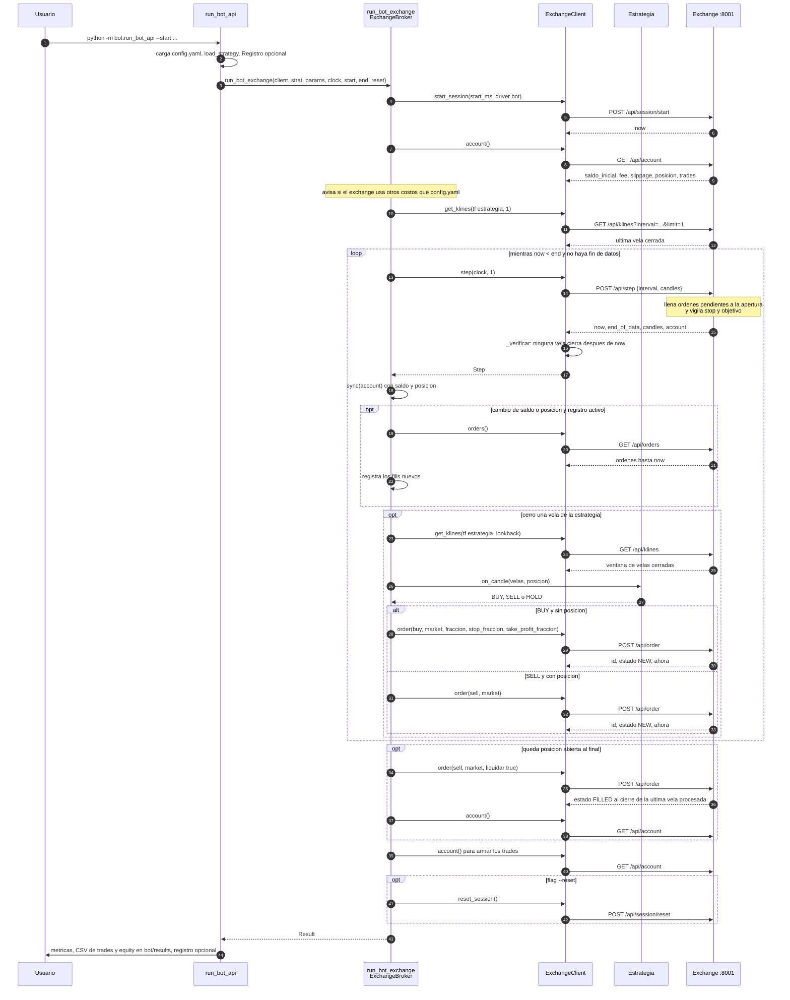
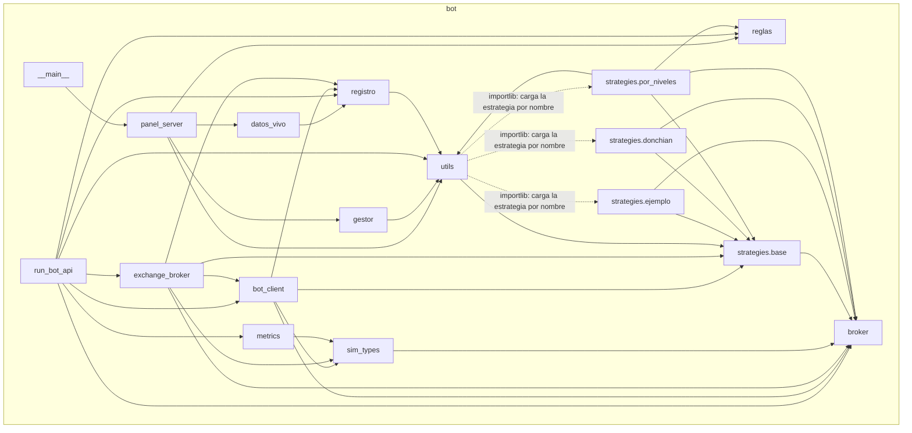
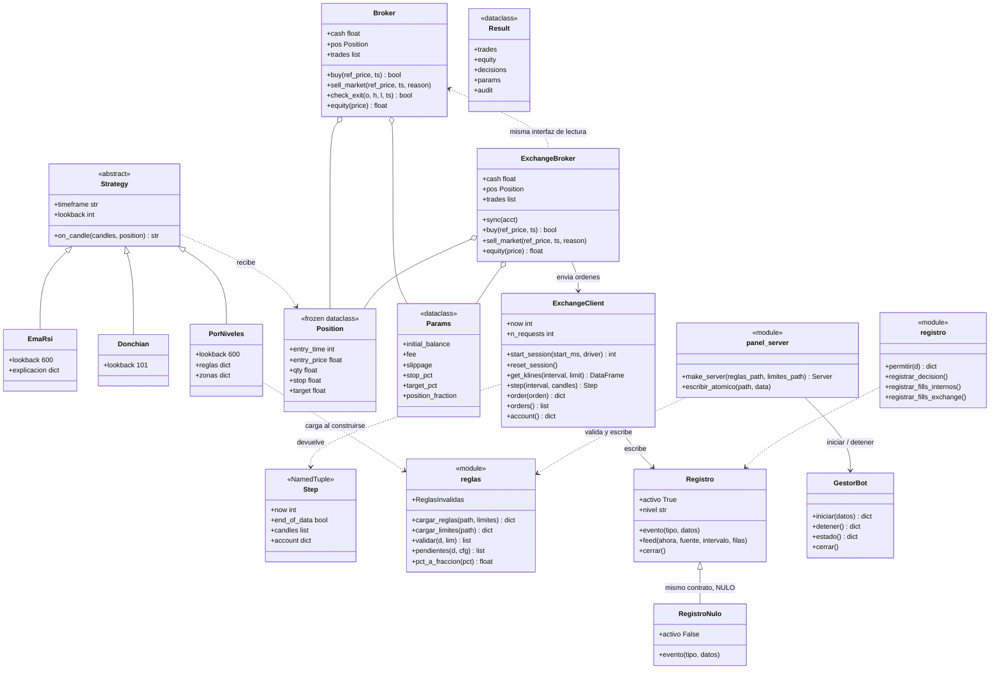
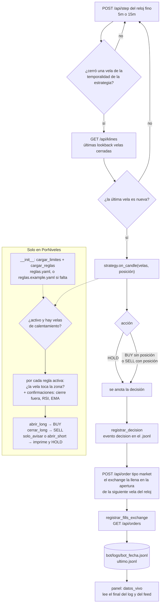
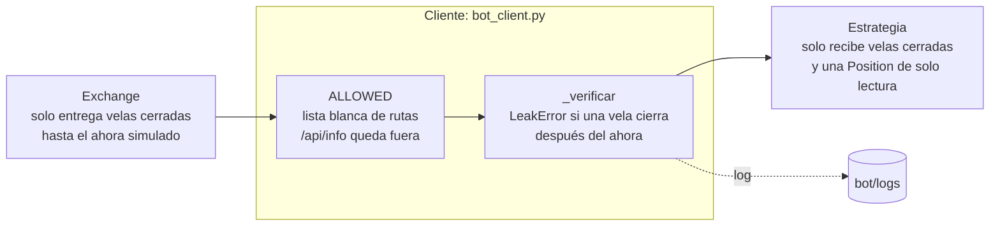

# Diagramas del bot

Diagramas Mermaid (se ven en GitHub) de este repo, hechos leyendo el código tal como queda tras separar el proyecto en dos repos:
este (**bot**, cliente HTTP sin datos) y `strategy-sandbox-exchange` (el mercado simulado y sus datos). El contrato con el
exchange está en [API_EXCHANGE.md](API_EXCHANGE.md). Donde algo no queda claro en el código lo marco con **?**.

Índice: [1 Arquitectura](#1-arquitectura) · [2 Secuencia de una corrida](#2-secuencia-de-una-corrida) ·
[3 Imports](#3-dependencias-de-imports) · [4 Clases](#4-diagrama-de-clases) · [5 Decisión por vela](#5-flujo-de-decisión-por-vela) ·
[6 Anti-futuro en el cliente](#6-cómo-se-garantiza-que-el-bot-no-ve-datos-futuros) · [Rarezas](#rarezas-e-inconsistencias-detectadas)

---

## 1. Arquitectura

Dos procesos de este repo: el panel de control (`python -m bot`, `127.0.0.1:8002`) y el bot (`bot.run_bot_api`), que el panel lanza
como proceso aparte. El bot solo habla con el exchange por HTTP (`EXCHANGE_URL`, por defecto `http://127.0.0.1:8001`).

Notas verificadas en el código:
- El panel no importa el bot: lo lanza con `subprocess` ([gestor.py](../bot/gestor.py)). Detener cierra solo el proceso que lanzó el panel.
- La ejecución es siempre `exchange`: `--ejecucion` solo acepta ese valor. `run_bot` (Broker interno) se conserva únicamente como referencia de los tests.
- Red configurable por entorno: `EXCHANGE_URL`, `PANEL_HOST`, `PANEL_PORT`, `PANEL_ALLOWED_HOSTS` (ver el [README](../bot/README.md)).

---

## 2. Secuencia de una corrida

`run_bot_api` crea el `ExchangeClient` y llama a `run_bot_exchange` ([exchange_broker.py](../bot/exchange_broker.py)).
Solo se usan rutas de la lista blanca `ALLOWED` ([bot_client.py](../bot/bot_client.py)); `/api/info` nunca.

Notas:
- Una orden enviada nunca se llena en el instante en que se envía: queda `NEW` y se llena en la apertura de la **siguiente** vela del reloj, dentro de `POST /api/step`. La excepción es `liquidar`, que cierra al cierre de la última vela ya procesada.
- `ExchangeBroker.trades` hace un `GET /api/account` cada vez que se lee ([exchange_broker.py](../bot/exchange_broker.py)); por eso aparece una consulta final de cuenta.
- Sin `--reset` la sesión queda abierta para verla en el visor del exchange.

---

## 3. Dependencias de imports

Generado leyendo los `import`/`from` reales de todos los `.py` de `bot/` (sin tests). El bot **no importa nada del exchange**:
un test lo impone ([test_imports.py](../bot/tests/test_imports.py)).

Cómo leerlo:
- `bot/utils.py` carga las estrategias dinámicamente con `importlib` (`bot.strategies.<nombre>`), por eso la flecha punteada.
- `panel_server` no importa `run_bot_api`: `gestor` lo lanza como subproceso.
- Las herramientas de simulación y verificación del repo del exchange sí importan `bot.broker`, `bot.metrics`, `bot.utils` y `bot.strategies.base` (por eso ese repo documenta una dependencia hacia este).

---

## 4. Diagrama de clases

Núcleo del bot. `ExchangeBroker` **no hereda** de `Broker`: copia su interfaz de lectura (duck typing). `run_bot_exchange` usa
`ExchangeBroker`, que delega en el exchange; `Broker` interno solo lo usa `run_bot` (referencia de los tests). Las reglas son funciones de módulo (`bot/reglas.py`), no una clase.

Notas:
- `Registro` y `RegistroNulo` no comparten clase base: `RegistroNulo` solo replica los métodos (`evento`, `feed`, `cerrar`) y la constante `NULO` se usa como valor por defecto (**?** en código no hay `class RegistroNulo(Registro)`).
- `run_bot` y `run_bot_exchange` son funciones, no métodos; ambas devuelven `Result` (la versión de `bot/sim_types.py`).
- `ejemplo.EmaRsi` expone `explicacion` (motivo y valores) que `registrar_decision` lee con `getattr`; `Donchian` y `PorNiveles` no la definen.

---

## 5. Flujo de decisión por vela

Qué pasa cuando cierra una vela de la temporalidad de la estrategia (`run_bot_exchange`). La estrategia `por_niveles`
carga `reglas.yaml` y `limites.yaml` **una sola vez, al construirse**, no en cada vela.

Notas:
- El `.jsonl` solo se escribe con `--log` o `--verbose` (el panel siempre lanza con `--log --log-nivel completo`); sin ellos el registro es `NULO` y no se escribe nada.
- La verificación posterior del log contra los datos (`verificar_log`) vive en el repo del exchange, porque necesita sus datos.
- `limites.yaml` se valida dos veces: el panel rechaza lo que lo supere al guardar y `PorNiveles` lo vuelve a validar al cargar (`cargar_reglas` → `validar`).
- Los campos que el `Broker` no soporta (`abrir_short`, `stop_pct` por regla, parciales, `riesgo_pct`) se guardan pero se **ignoran**; `pendientes()` los lista al arrancar ([por_niveles.py](../bot/strategies/por_niveles.py)).

---

## 6. Cómo se garantiza que el bot no ve datos futuros

Del lado del bot hay dos capas; el servidor (que solo entrega lo cerrado hasta el «ahora» simulado) se documenta en el repo del exchange.

| Capa | Dónde | Qué hace |
|---|---|---|
| Cliente, lista blanca | `ALLOWED` y `_request` en [bot_client.py](../bot/bot_client.py) | Rechaza cualquier ruta fuera de `ALLOWED` (`ExchangeError`); `/api/info` queda fuera. |
| Cliente, verificación | `_verificar` en [bot_client.py](../bot/bot_client.py) | `LeakError` si alguna vela recibida (en `klines` o `step`) cierra después del `now`. |
| Estrategia | [base.py](../bot/strategies/base.py) | La estrategia solo recibe las últimas `lookback` velas **cerradas** y una `Position` de solo lectura. |
| Panel | [datos_vivo.py](../bot/datos_vivo.py) | Solo lee el **final** del log y del feed, valida el nombre del feed y devuelve campos fijos. |

---

## Rarezas e inconsistencias detectadas

**Duplicación**
1. `Audit` y `Result` tienen copias propias en [sim_types.py](../bot/sim_types.py) (aislamiento: el bot no importa del exchange). `metrics.py` anota el tipo de `sim_types.Result`, pero el simulador directo del otro repo le pasa su propio `Result` (funciona por duck typing).
2. `interval_ms` / `_origin` ([bot_client.py](../bot/bot_client.py)) repiten a propósito lógica del servidor.
3. `rsi()` está copiada en [ejemplo.py](../bot/strategies/ejemplo.py) y [por_niveles.py](../bot/strategies/por_niveles.py).

**Acoplamientos y estilo**
4. [exchange_broker.py](../bot/exchange_broker.py) importa `_origin` (privado) de `bot_client`. `ExchangeBroker.buy` y `sell_market` reciben `ref_price` y `ts` que no usan (compatibilidad con la interfaz de `Broker`), y `run_bot_exchange` ignora el booleano que devuelve `buy`.
5. Estilo de imports mezclado: `strategies/*` usan absolutos (`from bot.broker import …`); el resto, relativos.
6. `ExchangeBroker.trades` es una propiedad que hace una petición HTTP cada vez que se lee.
7. `ExchangeBroker.sync` representa «sin stop» como `0.0` y «sin objetivo» como `inf` para encajar en `Position`, mientras que el exchange usa `None`.

**Comportamientos que no cuadran del todo**
8. `run_bot` (Broker interno, ya sin entrada por CLI) llama a `start_session` **sin** `driver`; solo `run_bot_exchange` declara `driver: "bot"`. Quedan `run_bot` y `registrar_fills_internos` solo por los tests de equivalencia con el exchange.
9. `run_bot_api` registra siempre el sha256 de `bot/reglas.yaml`, incluso con estrategias que no usan reglas. Si `reglas.yaml` faltara y se usara `reglas.example.yaml`, el log diría `ruta: bot/reglas.yaml` con `sha256: null` (**?** convendría registrar el archivo realmente cargado).
10. `PorNiveles` y `Donchian` no definen `explicacion`: en el log los eventos `decision` salen con `motivo: null`; solo `EmaRsi` lo rellena. `PorNiveles` además usa `print` dentro de `on_candle`.
11. `PorNiveles` acepta en `reglas.yaml` campos que ignora (`abrir_short`, `stop_pct` por regla, parcial, `riesgo_pct`); está documentado y se avisa al arrancar, pero el panel permite configurarlos.
